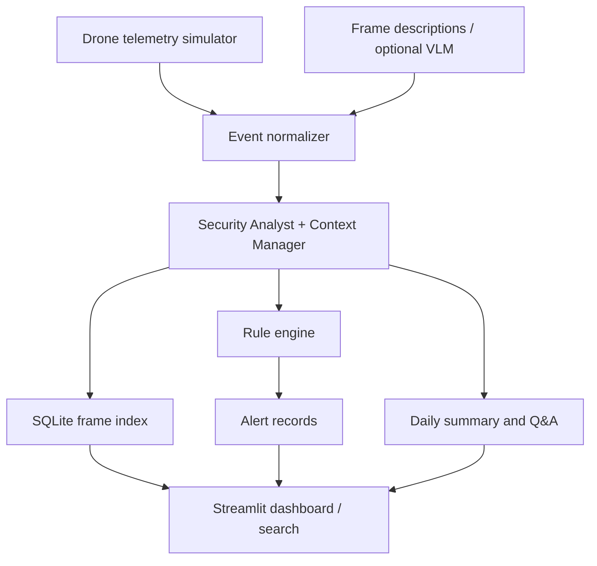

# Drone Security Analyst Agent

A local-first prototype for a docked-drone property security analyst. It processes simulated video-frame descriptions and telemetry, extracts events, indexes every frame in SQLite, applies security rules, and provides searchable logs, alerts, summaries, and follow-up questions.

> **Prototype scope:** The supplied demo uses simulated frame descriptions, as permitted by the assignment. It does not claim to perform production-grade object detection on live video. An optional Ollama vision adapter is included for experimenting with real images.

## Features

- Simulated frames paired with timestamp, location, altitude, and coordinates.
- Frame-by-frame SQLite indexing, including descriptions, objects, telemetry, and generated alerts.
- Repeated-object context: identify that the same vehicle appeared more than once in a day.
- Rule-based safety alerts, including midnight loitering near the main gate.
- Search by object, location, and time.
- Daily activity summary and simple follow-up question interface.
- Optional Ollama vision model adapter for image captioning.
- Optional LangChain/Ollama natural-language agent adapter.
- Automated tests.

## Architecture



See `docs/architecture.md` and `docs/feature_spec.md`.

## Requirements

- Windows 10 or 11
- Python 3.10 or newer (3.11 recommended)
- Internet only for initial package installation; core demo works locally afterwards

## Windows setup

Open PowerShell in the project folder.

```powershell
py -3.11 -m venv .venv
.\.venv\Scripts\Activate.ps1
python -m pip install --upgrade pip
pip install -r requirements.txt
```

If PowerShell blocks activation, run this once in the current terminal:

```powershell
Set-ExecutionPolicy -Scope Process -ExecutionPolicy Bypass
.\.venv\Scripts\Activate.ps1
```

## Run the dashboard

```powershell
streamlit run app.py
```

A browser tab should open at `http://localhost:8501`.

Use **Load / reset demo data** to load the sample scenario. The dashboard includes metrics, frame index, alerts, search, summary, and Q&A.

## Run the command-line demo

```powershell
python scripts/run_demo.py
```

## Run tests

```powershell
python -m unittest discover -s tests -v
```

## Optional: real-image VLM experiment with Ollama

1. Install Ollama from https://ollama.com/
2. Pull a vision model supported by your Ollama installation, for example:

```powershell
ollama pull llava
```

3. Start Ollama, then run:

```powershell
python scripts/caption_image.py path\to\your_image.jpg
```

The adapter sends one image to the local Ollama server. Model availability, RAM/VRAM, and inference speed depend on your computer. The default demo does not need Ollama.

## Optional: LangChain agent

Install optional dependencies:

```powershell
pip install -r requirements-ai.txt
```

Ensure Ollama is running and the model is available:

```powershell
ollama pull llama3.2
```

Then run:

```powershell
python scripts/ask_langchain.py "How many times was the blue Ford F150 seen?"
```

This optional agent uses the indexed event context supplied by the application. It is an experimental natural-language layer; the SQLite search and deterministic rules remain the source of truth.

## Sample expected behaviour

- `Blue Ford F150 spotted at Garage, 12:00`
- `Blue Ford F150 spotted at Main Gate, 14:00`
- `Person loitering at Main Gate, 00:01` (alert)
- Search `truck` returns both truck frames.
- Ask `How many times was the blue Ford F150 seen today?` and the answer uses the indexed records.

## Design decisions and assumptions

1. The assignment explicitly permits simulated video frames with text descriptions. This keeps the prototype reproducible without requiring a large labelled dataset or GPU.
2. SQLite is used because it is lightweight, local, queryable, and requires no database server. Each frame is a row with a timestamp and structured telemetry.
3. A deterministic rule engine is used for auditable alerts. It can be extended with learned anomaly detection after collecting representative data.
4. The same-day repeated-vehicle example is represented by normalized object labels. A real system would need vehicle re-identification and confidence scores, not only text matching.
5. Loitering is simulated with a frame description containing a dwell duration. A real system should track person IDs across consecutive frames and calculate dwell time.
6. The optional VLM adapter uses Ollama locally. The optional LangChain adapter uses Ollama chat locally. Neither is required for the sample run.

## AI-assisted development disclosure

This project was drafted with assistance from ChatGPT. AI assistance was used to structure the architecture, scaffold Python modules, propose alert rules, draft tests, and prepare documentation. The implementation should be reviewed, run, tested, and customized by the candidate before submission. In the final report, describe the actual tools and prompts you personally used; do not claim use of Claude Code, Cursor, or another tool unless you actually used it.

## Private GitHub submission checklist

1. Create a **private** GitHub repository.
2. Upload the project files (do not upload `.venv/`, generated database files, or personal images).
3. Add `assignments@flytbase.com` as a collaborator with the repository access requested by the assignment.
4. Verify the repository is private and the collaborator invitation is sent.
5. Record a voice-over demo showing the dashboard, search, alerts, summary, and tests.
6. Export the final report to PDF and share the demo video with appropriate viewing permissions.

## Limitations and next steps

- Replace text descriptions with a robust video pipeline using OpenCV and a selected VLM.
- Add persistent multi-object tracking and vehicle re-identification.
- Calibrate dwell-time and restricted-zone rules with property-specific policies.
- Add authentication, audit trails, alert delivery (email/SMS), retention policies, and encrypted storage.
- Evaluate precision/recall on a labelled dataset and test performance on long video streams.
- Add vector search for semantic retrieval if keyword search becomes insufficient.

## Confidentiality

Treat the assignment and your submission as confidential. Share only with the intended evaluator and follow the document's handling instructions.
